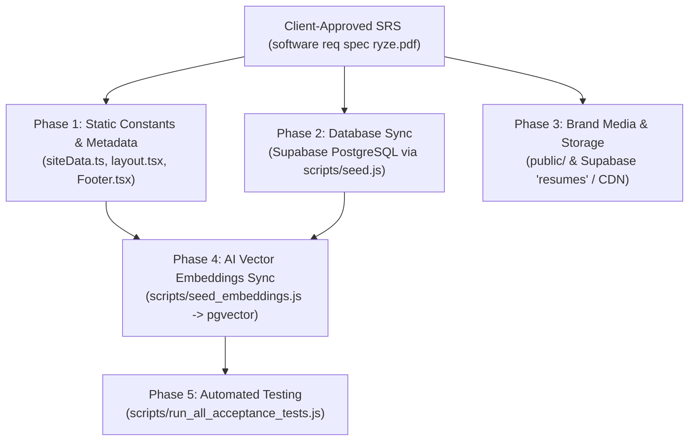
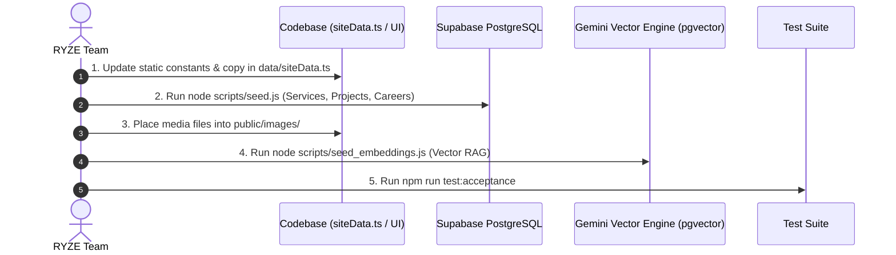

# RYZE WORKS — Master Content Placement Matrix & SRS Ingestion Guide

This document maps all 25 sections of the client intake questionnaire / Software Requirements Specification (`software req spec ryze.pdf`) directly to the corresponding files, database tables, components, and storage locations in the **RYZE WORKS** codebase.

---

## 1. Architectural Overview & Data Flow



---

## 2. 25-Section Master Content Placement Matrix

### Sections 1 & 2: Purpose, Positioning & General Company Information `[STATUS: ✅ APPROVED & INGESTED]`

> **Client Document Source:** `1 AND 2 PURPOSE,GENERAL COMPANY INFO.pdf`

| SRS Field | Client-Approved Value | Destination Codebase File(s) | Status |
| :--- | :--- | :--- | :--- |
| **Official Company Name** | **Ryzeworks** | [`data/siteData.ts`](file:///d:/RYZE%20WEBSITE/data/siteData.ts), [`app/layout.tsx`](file:///d:/RYZE%20WEBSITE/app/layout.tsx) | ✅ Ingested |
| **Parent Company** | **AINTRIX Global Pvt. Ltd.** | [`data/siteData.ts`](file:///d:/RYZE%20WEBSITE/data/siteData.ts), [`components/layout/Footer.tsx`](file:///d:/RYZE%20WEBSITE/components/layout/Footer.tsx), [`app/about/page.tsx`](file:///d:/RYZE%20WEBSITE/app/about/page.tsx) | ✅ Ingested |
| **Official Tagline** | *Vision Into Influence. Creativity Into Distinction.* | [`data/siteData.ts`](file:///d:/RYZE%20WEBSITE/data/siteData.ts), [`app/layout.tsx`](file:///d:/RYZE%20WEBSITE/app/layout.tsx), [`app/about/page.tsx`](file:///d:/RYZE%20WEBSITE/app/about/page.tsx) | ✅ Ingested |
| **Positioning** | *A creative and technology partner that helps businesses build stronger brands, create meaningful digital experiences and grow through content, marketing and digital solutions.* | [`data/siteData.ts`](file:///d:/RYZE%20WEBSITE/data/siteData.ts), [`app/layout.tsx`](file:///d:/RYZE%20WEBSITE/app/layout.tsx) | ✅ Ingested |
| **Primary Audiences** | Founders, SMEs, local and emerging brands, growing businesses, and organisations seeking branding, content, marketing, or automation support | [`data/siteData.ts`](file:///d:/RYZE%20WEBSITE/data/siteData.ts), Target Audience mapping | ✅ Ingested |
| **Primary Conversion Goal** | Qualified business enquiry / discovery call | [`app/start-a-project/page.tsx`](file:///d:/RYZE%20WEBSITE/app/start-a-project/page.tsx), [`app/contact/page.tsx`](file:///d:/RYZE%20WEBSITE/app/contact/page.tsx) | ✅ Ingested |
| **Year Established** | **2025** | [`data/siteData.ts`](file:///d:/RYZE%20WEBSITE/data/siteData.ts), [`app/about/page.tsx`](file:///d:/RYZE%20WEBSITE/app/about/page.tsx), [`components/layout/Footer.tsx`](file:///d:/RYZE%20WEBSITE/components/layout/Footer.tsx) | ✅ Ingested |
| **Director** | **Shanmuga Priya G** | [`data/siteData.ts`](file:///d:/RYZE%20WEBSITE/data/siteData.ts), [`app/about/page.tsx`](file:///d:/RYZE%20WEBSITE/app/about/page.tsx) | ✅ Ingested |
| **Current Location / Address** | **93/50, Ramakrishna Mutt Rd, Mandaveli, Chennai, Chennai -600028, Tamil Nadu** | [`data/siteData.ts`](file:///d:/RYZE%20WEBSITE/data/siteData.ts), [`app/contact/page.tsx`](file:///d:/RYZE%20WEBSITE/app/contact/page.tsx), [`components/layout/Footer.tsx`](file:///d:/RYZE%20WEBSITE/components/layout/Footer.tsx) | ✅ Ingested |
| **Official Email** | **teamryzeworks@gmail.com** | [`data/siteData.ts`](file:///d:/RYZE%20WEBSITE/data/siteData.ts), [`app/contact/page.tsx`](file:///d:/RYZE%20WEBSITE/app/contact/page.tsx), [`components/layout/Footer.tsx`](file:///d:/RYZE%20WEBSITE/components/layout/Footer.tsx) | ✅ Ingested |
| **Official Phone** | **8870605033 (+91 88706 05033)** | [`data/siteData.ts`](file:///d:/RYZE%20WEBSITE/data/siteData.ts), [`app/contact/page.tsx`](file:///d:/RYZE%20WEBSITE/app/contact/page.tsx), [`components/layout/Footer.tsx`](file:///d:/RYZE%20WEBSITE/components/layout/Footer.tsx) | ✅ Ingested |
| **Short Description** | "Ryzeworks is a creative branding and marketing company that transforms business visions into distinctive, memorable brands..." | [`data/siteData.ts`](file:///d:/RYZE%20WEBSITE/data/siteData.ts), [`app/layout.tsx`](file:///d:/RYZE%20WEBSITE/app/layout.tsx) (SEO) | ✅ Ingested |
| **Detailed Description** | Full story on challenging conventions, raising creative standards, and building brands that command attention | [`app/about/page.tsx`](file:///d:/RYZE%20WEBSITE/app/about/page.tsx), [`data/siteData.ts`](file:///d:/RYZE%20WEBSITE/data/siteData.ts) | ✅ Ingested |

---

### Section 3: Home Page Sections
| SRS Subsection | Content Requested | Destination Codebase File(s) | Destination Database / Storage |
| :--- | :--- | :--- | :--- |
| **3.1 Hero Section** | Main headline, subheadline, CTAs, Hero video/animation, numbers | `components/sections/IntroSequence.tsx`, `components/hero/HeroOrb.tsx`, `app/page.tsx` | N/A |
| **3.2 Company Introduction** | Short description, what RYZE does, differentiators, positioning | `components/sections/WhatWeDo.tsx`, `app/about/page.tsx` | N/A |
| **3.3 Trusted By / Clients** | Company names, verified logos, links, display approvals | `data/siteData.ts` (`TRUSTED_CLIENTS`), `components/sections/TrustedBy.tsx` | Supabase `projects` (if dynamic) |
| **3.4 Homepage Services** | Service names, descriptions, icons, CTAs, destination links | `data/siteData.ts` (`SERVICES_DATA`), `components/sections/WhatWeDo.tsx` | Supabase table: `services` |
| **3.5 Featured Projects** | Highlighted projects, thumbnails, tags, client names, links | `data/siteData.ts` (`FEATURED_PROJECTS`), `components/sections/FeaturedWork.tsx` | Supabase table: `projects` (`is_featured = true`) |
| **3.6 Testimonials** | Quotes, author names, roles, company names, avatars | `data/siteData.ts` (`TESTIMONIALS_DATA`), `components/sections/Testimonials.tsx` | Supabase table: `testimonials` (`status = 'approved'`) |
| **3.7 Latest Insights** | Featured articles, titles, categories, dates, authors, covers | `data/siteData.ts` (`ARTICLES_DATA`), `components/sections/LatestInsights.tsx` | Supabase table: `articles` (`status = 'published'`) |

---

### Section 4: About Page
| SRS Field Requested | Destination Codebase File(s) | Component / Layout Location |
| :--- | :--- | :--- |
| **Company Story & History** | `app/about/page.tsx` | Main narrative section |
| **Mission, Vision & Values** | `app/about/page.tsx` | Three-pillar philosophy cards |
| **Current Positioning & Differentiators** | `app/about/page.tsx` | Value proposition grid (`TiltCard3D`) |
| **Leadership / Team Profiles** (Name, Role, Bio, Photo, LinkedIn) | `app/about/page.tsx` | Team member cards, images in `public/images/team/` |
| **Company Statistics** (Experience, clients, projects, markets) | `app/about/page.tsx`, `components/ui/CounterNumber.tsx` | Animated stats row |

---

### Sections 5 & 6: Services & Individual Service Pages
| SRS Field Requested | Destination Codebase File(s) | Destination Database / Storage |
| :--- | :--- | :--- |
| **Core Service Structure** | `data/siteData.ts` (`SERVICES_DATA`), `app/services/page.tsx` | Supabase table: `services` |
| **Deliverables & Capabilities** | `components/services/ServiceCapabilityCard.tsx` | `services.deliverables` array |
| **Individual Service Pages** (`/services/[slug]`) | `app/services/[slug]/page.tsx` | Dynamic route powered by Supabase |
| **Process / Workflow Stages** | `app/services/[slug]/page.tsx` | Step-by-step roadmap UI |
| **Technologies & Tools Used** | `app/services/[slug]/page.tsx` | Tech stack pill badges |
| **Service-Specific Case Studies** | `app/services/[slug]/page.tsx` | Supabase table: `project_services` (M2M join) |

---

### Sections 7 & 8: Projects, Work & Case Studies
| SRS Field Requested | Destination Codebase File(s) | Destination Database / Storage |
| :--- | :--- | :--- |
| **Full Portfolio Projects Listing** | `app/projects/page.tsx`, `app/work/page.tsx`, `app/projects/ProjectsClient.tsx` | Supabase table: `projects` |
| **Project Details** (Description, requirement, contribution, URL, year) | `app/projects/[slug]/page.tsx` | Supabase table: `projects` |
| **Project Media** (Hero image, gallery, videos) | `components/projects/ProjectDetailHero.tsx` | `public/images/projects/` |
| **Case Study Deep-Dives** | `app/case-studies/page.tsx`, `app/case-studies/[slug]/page.tsx` | Supabase table: `case_studies` |
| **Challenge, Strategy, Execution, Results** | `app/case-studies/[slug]/page.tsx`, `data/siteData.ts` (`CASE_STUDIES`) | `case_studies` columns |
| **Verified Metrics & Data Points** | `components/sections/CaseStudies.tsx` | `case_studies.results` |
| **NDA & Confidentiality Filtering** | `supabase/schema.sql` (RLS policies) | Filter: `status = 'published'` & `is_verified = true` |

---

### Section 9: Testimonials Page
| SRS Field Requested | Destination Codebase File(s) | Destination Database / Storage |
| :--- | :--- | :--- |
| **Approved Testimonials Grid** | `app/testimonials/page.tsx`, `app/testimonials/TestimonialCard.tsx` | Supabase: `testimonials` (`status = 'approved'`) |
| **Public Submission Form** | `app/testimonials/TestimonialsSubmissionForm.tsx`, `app/api/testimonials/route.ts` | Inserts into `testimonials` with `status = 'pending'` |
| **Admin Moderation & Verification** | `app/admin/testimonials/page.tsx`, `app/admin/testimonials/actions.ts` | Admin CRUD (Approve / Reject / Toggle Verified) |

---

### Section 10: Insights / Blog / Articles
| SRS Field Requested | Destination Codebase File(s) | Destination Database / Storage |
| :--- | :--- | :--- |
| **Articles Directory & Filter** | `app/insights/page.tsx`, `app/insights/InsightsClient.tsx` | Supabase table: `articles` (`status = 'published'`) |
| **Article Detail Page** (Markdown/HTML content, reading time, SEO) | `app/insights/[slug]/page.tsx` | `articles.content`, `articles.seo_title` |
| **Admin Article Publishing Desk** | `app/admin/articles/page.tsx`, `app/admin/articles/ArticleEditorForm.tsx` | Full Server Actions: `createArticle`, `updateArticle` |
| **Reports (Downloadable Gated Research)** | `app/reports/page.tsx`, `data/reportsData.ts` | Lead capture via `components/reports/ReportDownloadForm.tsx` |
| **Resources & Playbooks** | `app/resources/page.tsx`, `data/resourcesData.ts` | Lead capture via `components/resources/ResourceDownloadForm.tsx` |

---

### Sections 11 & 12: Ryze AI & AI Lab
| SRS Field Requested | Destination Codebase File(s) | Destination Database / Engine |
| :--- | :--- | :--- |
| **Product Overview & Capabilities** | `app/ai/page.tsx`, `components/sections/RyzeAIPanel.tsx` | Gemini 3.6 Flash |
| **3D AI Neural Core Visualizer** | `components/ai/AiNeuralCore3D.tsx`, `components/spatial/CompanionAstronaut.tsx` | Three.js / WebGL |
| **AI Project Advisor / Consultation Chat** | `app/api/ai/chat/route.ts` | Grounded RAG with Supabase `knowledge_documents` |
| **AI Brief Generator** | `app/api/ai/brief/route.ts` | Generates AI scope & saves to `leads.ai_brief` |
| **Semantic Knowledge Search** | `app/api/ai/search/route.ts` | Vector search via `match_knowledge()` RPC (`pgvector`) |
| **AI Lab Initiatives & Research** | `app/ai/lab/page.tsx` | Static lab projects & experiments |

---

### Section 13: Careers Page
| SRS Field Requested | Destination Codebase File(s) | Destination Database / Storage |
| :--- | :--- | :--- |
| **Culture, Perks & Work Model** | `app/careers/page.tsx` | Static culture & benefit cards |
| **Open Positions Listing** | `app/careers/CareerRoleCard.tsx` | Supabase table: `career_roles` (`status = 'published'`) |
| **Application Submission Form** | `app/careers/page.tsx`, `app/api/careers/apply/route.ts` | Supabase table: `job_applications` |
| **Resume Upload Storage** | `app/api/careers/apply/route.ts` | Supabase Storage Bucket: `resumes` (Private RLS) |
| **Admin Hiring Desk** | `app/admin/careers/page.tsx`, `app/admin/careers/ApplicationsDeskClient.tsx` | Admin management (`submitted`, `reviewing`, `hired`) |

---

### Section 14: Contact Page & Lead Capture
| SRS Field Requested | Destination Codebase File(s) | Destination Database / Storage |
| :--- | :--- | :--- |
| **General Contact Details & Address** | `app/contact/page.tsx`, `data/siteData.ts` (`SITE_CONTACT`) | Contact cards |
| **Department Routing** (Business, Careers, Media, Support) | `app/contact/page.tsx` | Form routing logic |
| **Inbound Lead Submission / Start a Project** | `app/start-a-project/page.tsx`, `app/api/leads/route.ts` | Inserts into Supabase `leads` with Zod validation |
| **Admin Leads Inbox** | `app/admin/leads/page.tsx`, `app/admin/leads/LeadsDeskClient.tsx` | Admin status updates (`new`, `contacted`, `converted`) |

---

### Sections 15 & 16: Partnerships, Advertise & Media Kit
| SRS Field Requested | Destination Codebase File(s) | Destination Database / Storage |
| :--- | :--- | :--- |
| **Partnership Tiers & Process** | `app/partners/page.tsx` | Partner benefits & CTA |
| **Advertising Options & Commercial Form** | `app/advertise/page.tsx`, `components/commercial/AdvertiserInquiryForm.tsx` | Inserts into `leads` (`type = 'advertising'`) |
| **Downloadable Media Kit** | `app/media-kit/page.tsx` | `public/downloads/ryze-media-kit.pdf` |

---

### Sections 17 & 19: Social Media & Brand Assets
| SRS Field Requested | Destination Codebase File(s) | Destination Database / Storage |
| :--- | :--- | :--- |
| **Active Social Handles** | `components/layout/Footer.tsx`, `components/layout/Navbar.tsx` | Static constants |
| **Logos (SVG, PNG, Light, Dark)** | `public/images/`, `components/layout/Navbar.tsx`, `app/favicon.ico` | CDN / Static assets |
| **Brand Photography & Graphics** | `public/images/` | Static assets |

---

### Sections 18, 20–24: Legal, Compliance, Governance & Exclusions
| SRS Field Requested | Destination Codebase File(s) | Governance & RLS Rules |
| :--- | :--- | :--- |
| **Privacy Policy** | `app/privacy/page.tsx` | GDPR / DPDP compliance copy |
| **Terms of Use** | `app/terms/page.tsx` | Legal disclaimers & IP protection |
| **Cookie Policy** | `app/cookie-policy/page.tsx` | Cookie categories & tracking disclosures |
| **AI Disclosure Statement** | `app/ai-disclosure/page.tsx` | AI generation transparency & boundaries |
| **NDA / Confidentiality Guard** | `supabase/schema.sql` | RLS strict filter: `status = 'published'` & `is_verified = true` |
| **Content Approval Contacts** | `supabase` `profiles` table | Admin roles (`editor`, `admin`) |

---

## 3. Ingestion & Execution Pipeline



### Ingestion Commands:
1. **Database Seeding:**
   ```bash
   node scripts/seed.js
   ```
2. **AI Embeddings Generation:**
   ```bash
   node scripts/seed_embeddings.js
   ```
3. **Run Acceptance Testing:**
   ```bash
   npm run test:acceptance
   ```
4. **Development Preview:**
   ```bash
   npm run dev
   ```

