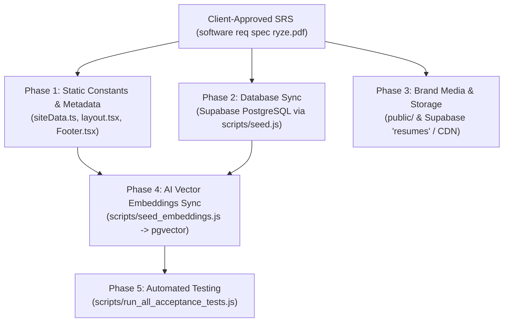
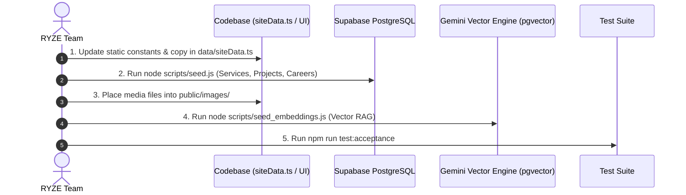

# RYZE WORKS — Master Content Placement Matrix & SRS Ingestion Guide

This document maps all 25 sections of the client intake questionnaire / Software Requirements Specification (`software req spec ryze.pdf`) directly to the corresponding files, database tables, components, and storage locations in the **RYZE WORKS** codebase.

---

## 1. Architectural Overview & Data Flow



---

## 2. 25-Section Master Content Placement Matrix

### Sections 1 & 2: Purpose, Positioning & General Company Information `[STATUS: ✅ APPROVED & INGESTED]`

> **Client Document Source:** `1 AND 2 PURPOSE,GENERAL COMPANY INFO.pdf`

| SRS Field | Client-Approved Value | Destination Codebase File(s) | Status |
| :--- | :--- | :--- | :--- |
| **Official Company Name** | **Ryzeworks** | [`data/siteData.ts`](file:///d:/RYZE%20WEBSITE/data/siteData.ts), [`app/layout.tsx`](file:///d:/RYZE%20WEBSITE/app/layout.tsx) | ✅ Ingested |
| **Parent Company** | **AINTRIX Global Pvt. Ltd.** | [`data/siteData.ts`](file:///d:/RYZE%20WEBSITE/data/siteData.ts), [`components/layout/Footer.tsx`](file:///d:/RYZE%20WEBSITE/components/layout/Footer.tsx), [`app/about/page.tsx`](file:///d:/RYZE%20WEBSITE/app/about/page.tsx) | ✅ Ingested |
| **Official Tagline** | *Vision Into Influence. Creativity Into Distinction.* | [`data/siteData.ts`](file:///d:/RYZE%20WEBSITE/data/siteData.ts), [`app/layout.tsx`](file:///d:/RYZE%20WEBSITE/app/layout.tsx), [`app/about/page.tsx`](file:///d:/RYZE%20WEBSITE/app/about/page.tsx) | ✅ Ingested |
| **Positioning** | *A creative and technology partner that helps businesses build stronger brands, create meaningful digital experiences and grow through content, marketing and digital solutions.* | [`data/siteData.ts`](file:///d:/RYZE%20WEBSITE/data/siteData.ts), [`app/layout.tsx`](file:///d:/RYZE%20WEBSITE/app/layout.tsx) | ✅ Ingested |
| **Primary Audiences** | Founders, SMEs, local and emerging brands, growing businesses, and organisations seeking branding, content, marketing, or automation support | [`data/siteData.ts`](file:///d:/RYZE%20WEBSITE/data/siteData.ts), Target Audience mapping | ✅ Ingested |
| **Primary Conversion Goal** | Qualified business enquiry / discovery call | [`app/start-a-project/page.tsx`](file:///d:/RYZE%20WEBSITE/app/start-a-project/page.tsx), [`app/contact/page.tsx`](file:///d:/RYZE%20WEBSITE/app/contact/page.tsx) | ✅ Ingested |
| **Year Established** | **2025** | [`data/siteData.ts`](file:///d:/RYZE%20WEBSITE/data/siteData.ts), [`app/about/page.tsx`](file:///d:/RYZE%20WEBSITE/app/about/page.tsx), [`components/layout/Footer.tsx`](file:///d:/RYZE%20WEBSITE/components/layout/Footer.tsx) | ✅ Ingested |
| **Director** | **Shanmuga Priya G** | [`data/siteData.ts`](file:///d:/RYZE%20WEBSITE/data/siteData.ts), [`app/about/page.tsx`](file:///d:/RYZE%20WEBSITE/app/about/page.tsx) | ✅ Ingested |
| **Current Location / Address** | **93/50, Ramakrishna Mutt Rd, Mandaveli, Chennai, Chennai -600028, Tamil Nadu** | [`data/siteData.ts`](file:///d:/RYZE%20WEBSITE/data/siteData.ts), [`app/contact/page.tsx`](file:///d:/RYZE%20WEBSITE/app/contact/page.tsx), [`components/layout/Footer.tsx`](file:///d:/RYZE%20WEBSITE/components/layout/Footer.tsx) | ✅ Ingested |
| **Official Email** | **teamryzeworks@gmail.com** | [`data/siteData.ts`](file:///d:/RYZE%20WEBSITE/data/siteData.ts), [`app/contact/page.tsx`](file:///d:/RYZE%20WEBSITE/app/contact/page.tsx), [`components/layout/Footer.tsx`](file:///d:/RYZE%20WEBSITE/components/layout/Footer.tsx) | ✅ Ingested |
| **Official Phone** | **8870605033 (+91 88706 05033)** | [`data/siteData.ts`](file:///d:/RYZE%20WEBSITE/data/siteData.ts), [`app/contact/page.tsx`](file:///d:/RYZE%20WEBSITE/app/contact/page.tsx), [`components/layout/Footer.tsx`](file:///d:/RYZE%20WEBSITE/components/layout/Footer.tsx) | ✅ Ingested |
| **Short Description** | "Ryzeworks is a creative branding and marketing company that transforms business visions into distinctive, memorable brands..." | [`data/siteData.ts`](file:///d:/RYZE%20WEBSITE/data/siteData.ts), [`app/layout.tsx`](file:///d:/RYZE%20WEBSITE/app/layout.tsx) (SEO) | ✅ Ingested |
| **Detailed Description** | Full story on challenging conventions, raising creative standards, and building brands that command attention | [`app/about/page.tsx`](file:///d:/RYZE%20WEBSITE/app/about/page.tsx), [`data/siteData.ts`](file:///d:/RYZE%20WEBSITE/data/siteData.ts) | ✅ Ingested |

---

### Section 3: Home Page Sections `[STATUS: 🟡 PARTIALLY INGESTED — PENDING ASSETS & PROJECTS]`

> **Client Document Source:** `section 3,4,5.pdf`

| SRS Subsection | Content Received / Status | Destination Codebase File(s) | Status |
| :--- | :--- | :--- | :--- |
| **3.1 Hero Section** | **Headline:** "From Brand Recognition to Business Conversion."<br/>**Subtitle:** "Strategic branding, purposeful content, cinematic creativity and performance-driven marketing..."<br/>**CTAs:** "Let's Turn Your Brand Into Your Competitive Edge" & "Explore Our Creative Work" | [`components/sections/IntroSequence.tsx`](file:///d:/RYZE%20WEBSITE/components/sections/IntroSequence.tsx) | ✅ Ingested |
| **3.2 Company Introduction** | What RYZE does, 6 Target Industries, 6 Differentiators, Positioning statement | [`components/sections/WhatWeDo.tsx`](file:///d:/RYZE%20WEBSITE/components/sections/WhatWeDo.tsx), [`app/about/page.tsx`](file:///d:/RYZE%20WEBSITE/app/about/page.tsx) | ✅ Ingested |
| **3.3 Trusted By / Clients** | 7 Client Names: `Velve unisex salon`, `Eththisai`, `Happy Break`, `Hair Mechanix`, `SAS Fitness`, `Reybha Couture`, `MRL solutions` | [`data/siteData.ts`](file:///d:/RYZE%20WEBSITE/data/siteData.ts) (`TRUSTED_CLIENTS`), [`components/sections/TrustedBy.tsx`](file:///d:/RYZE%20WEBSITE/components/sections/TrustedBy.tsx) | 🟡 Names Ingested (Logos & permissions pending) |
| **3.4 Homepage Services** | 10 Services (Video Production, Social Media Handling, Branding, Creative & Design, Influencer Mktg, Performance Mktg, Website Building, Ad Films, Creative Strategy, Content Creation) | [`data/siteData.ts`](file:///d:/RYZE%20WEBSITE/data/siteData.ts) (`SERVICES_DATA`), [`components/sections/WhatWeDo.tsx`](file:///d:/RYZE%20WEBSITE/components/sections/WhatWeDo.tsx) | 🟡 10 Services received |
| **3.5 Featured Projects** | *Not provided yet in PDF* | [`data/siteData.ts`](file:///d:/RYZE%20WEBSITE/data/siteData.ts) (`FEATURED_PROJECTS`), [`components/sections/FeaturedWork.tsx`](file:///d:/RYZE%20WEBSITE/components/sections/FeaturedWork.tsx) | ❌ PENDING FROM CLIENT |
| **3.6 Testimonials** | Explicitly marked `Testimonials: NA` | [`data/siteData.ts`](file:///d:/RYZE%20WEBSITE/data/siteData.ts) (`TESTIMONIALS_DATA`), [`components/sections/Testimonials.tsx`](file:///d:/RYZE%20WEBSITE/components/sections/Testimonials.tsx) | ⚠️ Marked NA (Needs confirmation if hidden) |
| **3.7 Latest Insights** | 5 Categories (Branding, Business Growth, Creative & Design, Digital Marketing, Content Strategy) | [`data/siteData.ts`](file:///d:/RYZE%20WEBSITE/data/siteData.ts) (`ARTICLES_DATA`), [`components/sections/LatestInsights.tsx`](file:///d:/RYZE%20WEBSITE/components/sections/LatestInsights.tsx) | 🟡 Categories added (Articles pending) |

---

### Section 4: About Page `[STATUS: 🟡 PARTIALLY INGESTED — PENDING TEAM & STATS]`

> **Client Document Source:** `section 3,4,5.pdf`

| SRS Field | Content Received / Status | Destination Codebase File(s) | Status |
| :--- | :--- | :--- | :--- |
| **Company Narrative & Why Established** | Redefining creativity and marketing in the Indian market; challenging conventions | [`app/about/page.tsx`](file:///d:/RYZE%20WEBSITE/app/about/page.tsx) | ✅ Ingested |
| **Mission & Vision** | Mission: Redefine standards & empower talent. Vision: Build pioneering Creative Infrastructure | [`app/about/page.tsx`](file:///d:/RYZE%20WEBSITE/app/about/page.tsx) | ✅ Ingested |
| **8 Core Values** | 1. Think Beyond Convention, 2. Ownership in Everything, 3. Integrity Over Convenience, 4. People Before Hierarchy, 5. Create With Purpose, 6. Courage to Create Differently, 7. Grow Through Learning, 8. Collective Progress | [`app/about/page.tsx`](file:///d:/RYZE%20WEBSITE/app/about/page.tsx) | ✅ Ingested |
| **Positioning** | Current: Creative & Marketing Agency. Long-term: Creative Infrastructure | [`app/about/page.tsx`](file:///d:/RYZE%20WEBSITE/app/about/page.tsx) | ✅ Ingested |
| **7 Key Differentiators** | Strategy Before Aesthetics, Cinematic Excellence, Marketing with Business Intent, People-Centred Culture, etc. | [`app/about/page.tsx`](file:///d:/RYZE%20WEBSITE/app/about/page.tsx) | ✅ Ingested |
| **Leadership / Team Profiles** | Director Shanmuga Priya G named; *other team members, photos, bios, LinkedIn links not sent* | [`app/about/page.tsx`](file:///d:/RYZE%20WEBSITE/app/about/page.tsx) | ❌ PENDING FROM CLIENT |
| **Company Statistics** | *No verified metrics/numbers provided* | [`app/about/page.tsx`](file:///d:/RYZE%20WEBSITE/app/about/page.tsx) | ❌ PENDING FROM CLIENT |

---

### Sections 5 & 6: Services & Individual Service Pages `[STATUS: 🟡 SERVICE CATALOGUE OUTLINED]`

> **Client Document Source:** `section 3,4,5.pdf`

| SRS Field | Content Received / Status | Destination Codebase File(s) | Status |
| :--- | :--- | :--- | :--- |
| **10 Service Names & Short Descriptions** | Outlined: Video Production, Social Media Handling, Branding, Creative & Design, Influencer Mktg, Performance Mktg, Website Building, Ad Films, Creative Strategy, Content Creation | [`app/services/page.tsx`](file:///d:/RYZE%20WEBSITE/app/services/page.tsx), [`data/siteData.ts`](file:///d:/RYZE%20WEBSITE/data/siteData.ts) | 🟡 Outlined |
| **Detailed Deliverables per Service** | *Not provided yet (needs bulleted deliverable list for each service)* | [`components/services/ServiceCapabilityCard.tsx`](file:///d:/RYZE%20WEBSITE/components/services/ServiceCapabilityCard.tsx) | ❌ PENDING FROM CLIENT |
| **Process / Workflow Stages** | *Not provided yet (needs workflow step breakdown)* | [`app/services/[slug]/page.tsx`](file:///d:/RYZE%20WEBSITE/app/services/[slug]/page.tsx) | ❌ PENDING FROM CLIENT |
| **Technologies & Tools Used** | *Not provided yet* | [`app/services/[slug]/page.tsx`](file:///d:/RYZE%20WEBSITE/app/services/[slug]/page.tsx) | ❌ PENDING FROM CLIENT |
| **Related Projects per Service** | *Not provided yet* | Supabase table: `project_services` | ❌ PENDING FROM CLIENT |

---

### Sections 7 & 8: Projects, Work & Case Studies
| SRS Field Requested | Destination Codebase File(s) | Destination Database / Storage |
| :--- | :--- | :--- |
| **Full Portfolio Projects Listing** | `app/projects/page.tsx`, `app/work/page.tsx`, `app/projects/ProjectsClient.tsx` | Supabase table: `projects` |
| **Project Details** (Description, requirement, contribution, URL, year) | `app/projects/[slug]/page.tsx` | Supabase table: `projects` |
| **Project Media** (Hero image, gallery, videos) | `components/projects/ProjectDetailHero.tsx` | `public/images/projects/` |
| **Case Study Deep-Dives** | `app/case-studies/page.tsx`, `app/case-studies/[slug]/page.tsx` | Supabase table: `case_studies` |
| **Challenge, Strategy, Execution, Results** | `app/case-studies/[slug]/page.tsx`, `data/siteData.ts` (`CASE_STUDIES`) | `case_studies` columns |
| **Verified Metrics & Data Points** | `components/sections/CaseStudies.tsx` | `case_studies.results` |
| **NDA & Confidentiality Filtering** | `supabase/schema.sql` (RLS policies) | Filter: `status = 'published'` & `is_verified = true` |

---

### Section 9: Testimonials Page
| SRS Field Requested | Destination Codebase File(s) | Destination Database / Storage |
| :--- | :--- | :--- |
| **Approved Testimonials Grid** | `app/testimonials/page.tsx`, `app/testimonials/TestimonialCard.tsx` | Supabase: `testimonials` (`status = 'approved'`) |
| **Public Submission Form** | `app/testimonials/TestimonialsSubmissionForm.tsx`, `app/api/testimonials/route.ts` | Inserts into `testimonials` with `status = 'pending'` |
| **Admin Moderation & Verification** | `app/admin/testimonials/page.tsx`, `app/admin/testimonials/actions.ts` | Admin CRUD (Approve / Reject / Toggle Verified) |

---

### Section 10: Insights / Blog / Articles
| SRS Field Requested | Destination Codebase File(s) | Destination Database / Storage |
| :--- | :--- | :--- |
| **Articles Directory & Filter** | `app/insights/page.tsx`, `app/insights/InsightsClient.tsx` | Supabase table: `articles` (`status = 'published'`) |
| **Article Detail Page** (Markdown/HTML content, reading time, SEO) | `app/insights/[slug]/page.tsx` | `articles.content`, `articles.seo_title` |
| **Admin Article Publishing Desk** | `app/admin/articles/page.tsx`, `app/admin/articles/ArticleEditorForm.tsx` | Full Server Actions: `createArticle`, `updateArticle` |
| **Reports (Downloadable Gated Research)** | `app/reports/page.tsx`, `data/reportsData.ts` | Lead capture via `components/reports/ReportDownloadForm.tsx` |
| **Resources & Playbooks** | `app/resources/page.tsx`, `data/resourcesData.ts` | Lead capture via `components/resources/ResourceDownloadForm.tsx` |

---

### Sections 11 & 12: Ryze AI & AI Lab
| SRS Field Requested | Destination Codebase File(s) | Destination Database / Engine |
| :--- | :--- | :--- |
| **Product Overview & Capabilities** | `app/ai/page.tsx`, `components/sections/RyzeAIPanel.tsx` | Gemini 3.6 Flash |
| **3D AI Neural Core Visualizer** | `components/ai/AiNeuralCore3D.tsx` | Three.js / WebGL |
| **AI Project Advisor / Consultation Chat** | `app/api/ai/chat/route.ts` | Grounded RAG with Supabase `knowledge_documents` |
| **AI Brief Generator** | `app/api/ai/brief/route.ts` | Generates AI scope & saves to `leads.ai_brief` |
| **Semantic Knowledge Search** | `app/api/ai/search/route.ts` | Vector search via `match_knowledge()` RPC (`pgvector`) |
| **AI Lab Initiatives & Research** | `app/ai/lab/page.tsx` | Static lab projects & experiments |

---

### Section 13: Careers Page
| SRS Field Requested | Destination Codebase File(s) | Destination Database / Storage |
| :--- | :--- | :--- |
| **Culture, Perks & Work Model** | `app/careers/page.tsx` | Static culture & benefit cards |
| **Open Positions Listing** | `app/careers/CareerRoleCard.tsx` | Supabase table: `career_roles` (`status = 'published'`) |
| **Application Submission Form** | `app/careers/page.tsx`, `app/api/careers/apply/route.ts` | Supabase table: `job_applications` |
| **Resume Upload Storage** | `app/api/careers/apply/route.ts` | Supabase Storage Bucket: `resumes` (Private RLS) |
| **Admin Hiring Desk** | `app/admin/careers/page.tsx`, `app/admin/careers/ApplicationsDeskClient.tsx` | Admin management (`submitted`, `reviewing`, `hired`) |

---

### Section 14: Contact Page & Lead Capture
| SRS Field Requested | Destination Codebase File(s) | Destination Database / Storage |
| :--- | :--- | :--- |
| **General Contact Details & Address** | `app/contact/page.tsx`, `data/siteData.ts` (`SITE_CONTACT`) | Contact cards |
| **Department Routing** (Business, Careers, Media, Support) | `app/contact/page.tsx` | Form routing logic |
| **Inbound Lead Submission / Start a Project** | `app/start-a-project/page.tsx`, `app/api/leads/route.ts` | Inserts into Supabase `leads` with Zod validation |
| **Admin Leads Inbox** | `app/admin/leads/page.tsx`, `app/admin/leads/LeadsDeskClient.tsx` | Admin status updates (`new`, `contacted`, `converted`) |

---

### Sections 15 & 16: Partnerships, Advertise & Media Kit
| SRS Field Requested | Destination Codebase File(s) | Destination Database / Storage |
| :--- | :--- | :--- |
| **Partnership Tiers & Process** | `app/partners/page.tsx` | Partner benefits & CTA |
| **Advertising Options & Commercial Form** | `app/advertise/page.tsx`, `components/commercial/AdvertiserInquiryForm.tsx` | Inserts into `leads` (`type = 'advertising'`) |
| **Downloadable Media Kit** | `app/media-kit/page.tsx` | `public/downloads/ryze-media-kit.pdf` |

---

### Sections 17 & 19: Social Media & Brand Assets
| SRS Field Requested | Destination Codebase File(s) | Destination Database / Storage |
| :--- | :--- | :--- |
| **Active Social Handles** | `components/layout/Footer.tsx`, `components/layout/Navbar.tsx` | Static constants |
| **Logos (SVG, PNG, Light, Dark)** | `public/images/`, `components/layout/Navbar.tsx`, `app/favicon.ico` | CDN / Static assets |
| **Brand Photography & Graphics** | `public/images/` | Static assets |

---

### Sections 18, 20–24: Legal, Compliance, Governance & Exclusions
| SRS Field Requested | Destination Codebase File(s) | Governance & RLS Rules |
| :--- | :--- | :--- |
| **Privacy Policy** | `app/privacy/page.tsx` | GDPR / DPDP compliance copy |
| **Terms of Use** | `app/terms/page.tsx` | Legal disclaimers & IP protection |
| **Cookie Policy** | `app/cookie-policy/page.tsx` | Cookie categories & tracking disclosures |
| **AI Disclosure Statement** | `app/ai-disclosure/page.tsx` | AI generation transparency & boundaries |
| **NDA / Confidentiality Guard** | `supabase/schema.sql` | RLS strict filter: `status = 'published'` & `is_verified = true` |
| **Content Approval Contacts** | `supabase` `profiles` table | Admin roles (`editor`, `admin`) |

---

## 3. Ingestion & Execution Pipeline



### Ingestion Commands:
1. **Database Seeding:**
   ```bash
   node scripts/seed.js
   ```
2. **AI Embeddings Generation:**
   ```bash
   node scripts/seed_embeddings.js
   ```
3. **Run Acceptance Testing:**
   ```bash
   npm run test:acceptance
   ```
4. **Development Preview:**
   ```bash
   npm run dev
   ```

